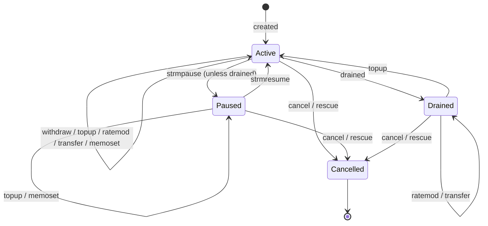

# Indexing donation streams

This guide explains how to consume `donation-vault` events in order, replay
them safely, and maintain a stream projection. For exact topic and data
shapes, see [`EVENTS.md`](./EVENTS.md); for contract storage and entry points,
see [`STORAGE.md`](./STORAGE.md) and [`STREAM_LIFECYCLE.md`](./STREAM_LIFECYCLE.md).

## Ordering and delivery

- Filter events by network and the deployed vault contract address. Keep the
  contract address (and deployment/network identity) with every indexed stream
  ID; IDs are only unique within a vault instance.
- Process ledgers in ascending ledger sequence, then transactions and events
  in the order returned by the network. Within a transaction, events appear in
  execution/publication order, including events from nested contract calls.
  Do not sort by topic or stream ID.
- A successful transaction's state changes and events commit together. A
  failed transaction does not provide committed stream changes to apply.
- A transaction may emit several events for one stream. For example, a
  withdrawal that empties a stream emits `withdraw` followed by `drained`;
  settling operations such as `modify_rate` may emit `drained` before their
  own event.
- These are event-order guarantees, not a promise that every state change has
  an event. No-op calls do not emit, and some settlements are reported only in
  the operation event. See [State changes and event coverage](#state-changes-and-event-coverage).

Persist a cursor only after all events through that ledger have been applied.
If a consumer can receive an event more than once, make application
idempotent: use the RPC's stable event ID when available, or a key composed of
network, vault address, ledger hash, transaction hash, and event position.
`stream_id` alone is not an event key because a stream emits many events.
Apply each event and record its key atomically (or use an equivalent
transactional inbox); for downstream notifications, use an outbox or
idempotency key rather than sending the side effect again on every replay.

On restart, replay from the last fully committed ledger, or rebuild the
affected projection from an earlier cursor. If the network source exposes
ledger rollback/finality notifications, roll back to the last canonical
ledger before resuming. Keep the raw event and its ordering metadata so a
projection can be rebuilt after an indexer change.

## Stream state machine

The lifecycle states and transitions are:



`Active` and `Paused` streams have funds remaining. A `Drained` stream has
paid its entire balance but is not cancelled; `topup` can reactivate it.
`Cancelled` is terminal. A contract-wide `pause`/`unpause` is different from
the donor-controlled per-stream `strmpause`/`strmresume` state.

## State changes and event coverage

Use the event data as the source for amounts actually settled. Do not
recalculate accrual from elapsed time: it is capped by the remaining balance,
and settlement timing is determined by the contract.

| Event | Projection update |
| --- | --- |
| `created` | Create the stream with `balance = deposit`, `withdrawn = 0`, `rate`, donor, NGO, token, memo, and `status = Active`. |
| `withdraw` | Subtract `accrued` from balance; add it to cumulative `withdrawn`. `fee + net = accrued`. |
| `drained` | Set status to `Drained`; `total_paid` is the cumulative gross amount withdrawn at that point. |
| `topup` | Subtract `settled` from balance, add it to `withdrawn`, then add `amount` to balance. A previously drained stream becomes active. |
| `ratemod` | Subtract `settled` from balance, add it to `withdrawn`, and set the rate to `new_rate`. |
| `transfer` | Subtract `settled` from balance, add it to `withdrawn`, and set the NGO to `new_ngo`. |
| `strmpause` | Subtract `settled` from balance and add it to `withdrawn`. Set status to `Paused`, unless a preceding `drained` event in the same operation already set it to `Drained`. |
| `strmresume` | Set status to `Active`. |
| `cancel` | Add `accrued` to `withdrawn`; set balance and rate to zero and status to `Cancelled`. `refund` is returned to the donor, not paid to the NGO. |
| `rescue` | Set balance and rate to zero and status to `Cancelled`. `refund` is returned to the donor; rescue does not settle accrued funds to the NGO. |
| `memoset` | Replace memo with `new_memo`. |

`topup`, `ratemod`, `transfer`, and `strmpause` report any settled gross amount
in their own event; that settlement does **not** also emit `withdraw`. Add
their `settled` value to `withdrawn` exactly once. `cancel` similarly reports
its final settlement as `accrued`, and `rescue` deliberately reports only the
refund.

Events do not contain every field needed for an exact storage snapshot.
`created` does not include `start`, so a stream created with a future start
time needs a `get_stream` read (or the original creation arguments) to recover
that value. The event's ledger timestamp supplies `created_at`; for ordinary
streams, `start` equals it. A `cancel` event is emitted only if `accrued` or
`refund` is nonzero, so cancelling an already-drained stream can change its
stored status without a `cancel` event. No-op changes, such as setting the
existing rate, also emit nothing. If exact current storage status or fields
are required, reconcile the event projection against `get_stream`; events
alone are not a complete storage-change log.

For financial reporting, distinguish gross amounts from transfers: `withdraw`
includes fee, net, and payout destination, but the implicit settlements above
only report the gross amount. Use token transfer events or transaction
results as appropriate when you need to reconcile each actual recipient.

## Example: rebuild a stream projection

The following language-neutral pseudocode assumes the events have already
been filtered to the stream-related topics for one vault and sorted by
canonical ledger/transaction/event order. Persist `applied_event_keys`
alongside the projection so replaying a page does not apply its amounts twice.

```text
for event in ordered_events:
    if event.key in applied_event_keys:
        continue

    if event.topic not in {
        "created", "withdraw", "drained", "topup", "ratemod", "transfer",
        "strmpause", "strmresume", "cancel", "rescue", "memoset"
    }:
        continue

    match event.topic:
        "created":
            streams[event.stream_id] = {
                donor: event.donor, ngo: event.ngo, token: event.token,
                balance: event.deposit, withdrawn: 0, rate: event.rate,
                memo: event.memo, created_at: event.ledger_timestamp,
                start: unknown, status: Active
            }
        otherwise:
            s = streams[event.stream_id]
            apply_non_creation_event(s, event)

    persist(streams, event.key)

function apply_non_creation_event(s, event):
    match event.topic:
        "withdraw":
            s.balance -= event.accrued
            s.withdrawn += event.accrued
        "drained":
            s.status = Drained
        "topup":
            s.balance += event.amount - event.settled
            s.withdrawn += event.settled
            if s.status == Drained:
                s.status = Active
        "ratemod":
            s.balance -= event.settled
            s.withdrawn += event.settled
            s.rate = event.new_rate
        "transfer":
            s.balance -= event.settled
            s.withdrawn += event.settled
            s.ngo = event.new_ngo
        "strmpause":
            s.balance -= event.settled
            s.withdrawn += event.settled
            if s.status != Drained:
                s.status = Paused
        "strmresume":
            s.status = Active
        "cancel":
            s.withdrawn += event.accrued
            s.balance = 0
            s.rate = 0
            s.status = Cancelled
        "rescue":
            s.balance = 0
            s.rate = 0
            s.status = Cancelled
        "memoset":
            s.memo = event.new_memo
```

In production, validate that applied amounts do not make a balance negative,
handle unknown event topics according to the deployed contract version, and
preserve the raw event for future reprocessing. Backfill `start` from
`get_stream` while the record is available, or store the input when observing
the creation transaction. A live read returns current state, so it is not a
historical snapshot for fields that can later change.
